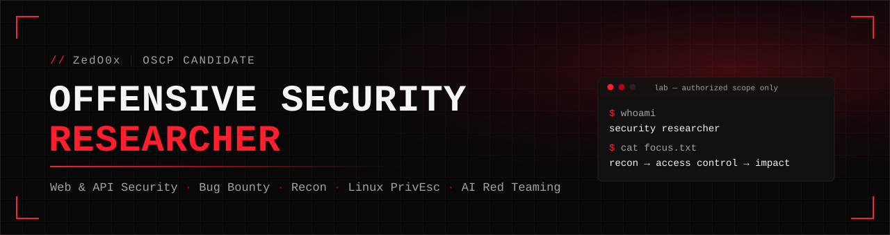
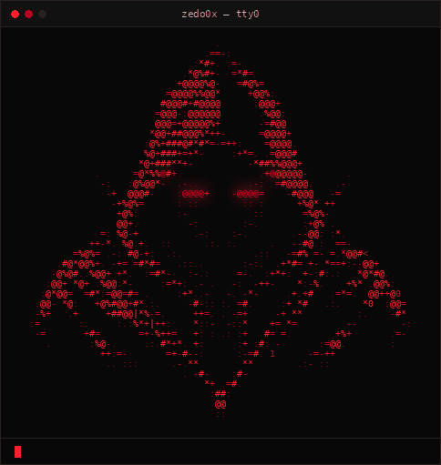
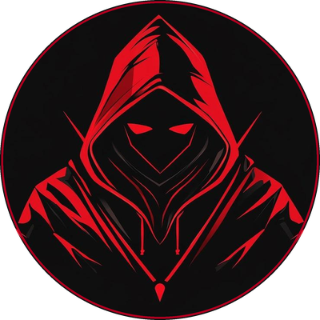

<p align="center">
  
</p>




### ZedO0x `|` Offensive Security Researcher

Bug bounty hunter and security researcher. I map attack surface, test how applications
enforce trust, and build Python tooling to make that work repeatable.


**What I do**<br>
<code>▸</code> Bug Bounty Hunting<br>
<code>▸</code> Web &amp; API Penetration Testing<br>
<code>▸</code> Security Automation with Python<br>
<code>▸</code> Reconnaissance &amp; Vulnerability Research


**In progress**<br>
<code>◇</code> Mobile Application Security: <i>currently developing</i><br>
<code>◇</code> AI Security &amp; Red Teaming: <i>currently developing</i><br>
<code>◇</code> OSCP Candidate: <i>actively preparing</i>

<br clear="both">

<p align="center">
  <a href="https://github.com/ZedO0x/privscout"></a>
  
  
  
</p>

<p align="center">
  <a href="#-about">About</a> ·
  <a href="#-skills">Skills</a> ·
  <a href="#-featured-projects">Projects</a> ·
  <a href="#-research">Research</a> ·
  <a href="#-roadmap">Roadmap</a> ·
  <a href="#-activity">Activity</a>
</p>


## ▸ About

```text
$ cat about.md
```

I work on the offensive side of security: finding where applications, APIs and hosts
fail to enforce the rules they think they enforce.

- **Bug bounty & vulnerability research.** I hunt on public programs, focused on access control,
  authentication, SSRF, file handling and API logic. I follow responsible disclosure, so program
  names, targets and findings stay private until triage is complete and disclosure is permitted.
- **Attack-surface discovery.** Recon is where most of my findings start: subdomains, live hosts,
  historical URLs, exposed services and forgotten endpoints.
- **Tooling.** When a workflow repeats, I automate it in Python or Bash. [PrivScout](https://github.com/ZedO0x/privscout)
  came out of my Linux privilege-escalation practice for OSCP.
- **Continuous practice.** I'm currently working through OSCP-style labs, plus mobile application
  testing and AI/LLM red teaming.


## ▸ Skills

<table>
  <tr>
    <th align="left" width="24%">Area</th>
    <th align="left" width="46%">Working knowledge</th>
    <th align="left" width="30%">Currently developing</th>
  </tr>
  <tr>
    <td><b>Web &amp; API Security</b></td>
    <td>OWASP Top 10 · broken access control / IDOR · authentication &amp; session testing · SSRF · XSS · SQL injection · CSRF · CORS · file-upload validation · rate-limiting abuse · GraphQL exposure · HTTP traffic analysis</td>
    <td>Advanced API authorization testing · vulnerability chaining</td>
  </tr>
  <tr>
    <td><b>Reconnaissance &amp; Enumeration</b></td>
    <td>Subdomain &amp; DNS enumeration · live-host probing · URL discovery &amp; crawling · content discovery · tech fingerprinting · subdomain-takeover checks · port &amp; service enumeration</td>
    <td>Automated recon pipelines</td>
  </tr>
  <tr>
    <td><b>Programming &amp; Automation</b></td>
    <td>Python (CLI security tools, parsing, reporting, pytest) · Bash scripting</td>
    <td>C for network tooling · larger Python automation</td>
  </tr>
  <tr>
    <td><b>Linux &amp; Networking</b></td>
    <td>Kali Linux · Linux privilege-escalation enumeration (sudo, SUID, capabilities, cron, services, PATH) · TCP/IP · DNS · subnetting · Nmap · Wireshark</td>
    <td>Active Directory fundamentals</td>
  </tr>
  <tr>
    <td><b>Vulnerability Research</b></td>
    <td>Bug bounty methodology · impact validation · responsible disclosure · report writing</td>
    <td>Exploit development fundamentals</td>
  </tr>
  <tr>
    <td><b>Mobile Application Security</b></td>
    <td>Android APK static analysis (decompilation, manifest &amp; exported-component review)</td>
    <td>Dynamic instrumentation (Frida, objection) · OWASP MASVS / MASTG</td>
  </tr>
  <tr>
    <td><b>AI Security &amp; Red Teaming</b></td>
    <td>Prompt injection &amp; jailbreak testing of LLM apps</td>
    <td>Agent tool-abuse, indirect injection and RAG attack paths</td>
  </tr>
  <tr>
    <td><b>Password Security</b></td>
    <td>Hashcat · John the Ripper · hash identification</td>
    <td>—</td>
  </tr>
</table>

**Toolbox**

<p>
  
  
  
  
  
  
  
  
  
  
</p>

<sub>Recon kit also includes assetfinder, waybackurls, dirsearch, gobuster, WhatWeb, subzy, dnsrecon, dnsenum and masscan.</sub>


## ▸ Featured Projects

### [PrivScout](https://github.com/ZedO0x/privscout) &nbsp;<sub>Linux privilege-escalation enumeration</sub>

A modular enumeration and assessment tool for authorized pentests, CTFs and labs. Instead of
dumping raw output, each module **analyzes** what it finds and emits structured,
severity-rated findings (INFO → CRITICAL).

| Module | What it checks |
|---|---|
| `system` · `users` | OS / kernel / identity, privileged group membership, extra UID 0 accounts |
| `sudo` | Parses `sudo -l -n`, flags full-access and GTFOBins-abusable rules |
| `suid` · `capabilities` | Classifies SUID/SGID binaries (standard / interesting / custom); flags dangerous file capabilities |
| `cron` · `services` · `processes` | Writable cron targets, writable systemd unit files, writable root-owned executables |
| `permissions` · `environment` | Risky access to passwd/shadow/sudoers; PATH hijacking and `LD_PRELOAD` risks |

**Engineering:** module registry with per-module CLI flags · one timeout-bounded, list-args-only command executor ·
TXT / JSON / HTML reports from the same findings · 124 pytest tests using mocked system state ·
reads only an allowlist of environment variables, so secrets never land in output.

```bash
git clone https://github.com/ZedO0x/privscout.git && cd privscout
pip install -r requirements.txt
python3 privscout.py --all --report      # full run + reports/report.{txt,json,html}
python3 privscout.py --sudo --suid       # targeted modules
```

<details>
<summary><b>Sample output</b> (real run on a Kali lab VM)</summary>
<br>

</details>

<sub>Python · Rich · pytest · MIT</sub>

---

### Zedx Recon &nbsp;<sub>Python reconnaissance &amp; DNS enumeration</sub>

A Python toolkit that brings DNS discovery and Nmap-based enumeration into a single
reconnaissance workflow, with parsed output and saved reports.

<sub>Python · Nmap · DNS tooling · <i>repository not yet public</i></sub>

---

### In the lab &nbsp;<sub>not yet published</sub>

| Project | Summary | Stack |
|---|---|---|
| **AI-RedTeam** | A modular framework for authorized testing of LLM apps and AI agents. Attack modules cover prompt injection, jailbreaks, prompt leakage, indirect injection, RAG, tool abuse and data exfiltration. Detectors produce scored findings and JSON / Markdown / HTML reports. | Python · Typer · pydantic |
| **Security Toolkit** | Five self-contained tools: DNS recon with misconfiguration checks, a web-recon pipeline, an HTTP security analyzer (headers, cookies, CORS, TLS), an intercepting HTTP(S) proxy, and a lightweight port scanner. | Python · C |
| **NetSentinel IDS** | A network IDS built on libpcap: packet parsing, flow tracking, port-scan and SYN-flood detection, SQLite alert storage. Under active development. | C · libpcap · SQLite |

---

### More repositories

| Repository | Summary |
|---|---|
| [**deepseek-jailbreak-research**](https://github.com/ZedO0x/deepseek-jailbreak-research) | Educational research into DeepSeek jailbreaks, prompt injection and AI safety guardrails. |
| [**logs-bot-zedx**](https://github.com/ZedO0x/logs-bot-zedx) | Python Discord bot that logs server activity: deleted/edited messages, joins/leaves, voice activity. |


## ▸ Research

Write-ups will be linked here as they're published. All public material is educational
or fully sanitized. No program names, private endpoints, credentials or undisclosed findings.

| Track | Focus |
|---|---|
| Broken Access Control &amp; IDOR | Object-level and function-level authorization, multi-tenant boundaries |
| API Authorization | Token scoping, mass assignment, GraphQL resolver exposure |
| Authentication &amp; Sessions | Account-linking / pre-account-takeover flaws, reset flows, rate limiting |
| Injection &amp; Client-Side | SQL injection, XSS, file-upload validation bypass |
| SSRF | Blind SSRF, out-of-band confirmation, internal reachability |
| Recon Methodology | Subdomain → live host → URL → endpoint pipelines |
| Linux Privilege Escalation | Sudo, SUID, capabilities, cron and PATH vectors. See [PrivScout](https://github.com/ZedO0x/privscout) |
| Mobile Application Security | Android app analysis against OWASP MASVS |

> **Disclosure policy:** testing is performed only within the scope and rules of authorized
> programs and labs. Findings are reported through official channels and never published before disclosure is permitted.


## ▸ Roadmap

Learning goals in progress (not completed certifications):

- **OSCP:** structured preparation and practical penetration-testing labs
- **Advanced web &amp; API security:** authorization logic, chaining, business-logic flaws
- **Active Directory:** enumeration, misconfigurations, lateral movement fundamentals
- **Mobile application pentesting:** Android static/dynamic analysis, MASVS/MASTG
- **AI security &amp; red teaming:** LLM and agent attack surfaces
- **Security automation:** publishing more of my Python tooling


## ▸ Activity

<p align="center">
  
  
</p>


<p align="center">
  <sub>Open to collaboration on security tooling and research.<br>
  All tools and content here are for <b>authorized security testing and education only</b>.</sub>
</p>

<!--
  Contact links — add real URLs when ready, then move them into the header badges row:
  LinkedIn:  https://www.linkedin.com/in/<handle>
  HackerOne: https://hackerone.com/<handle>
-->
